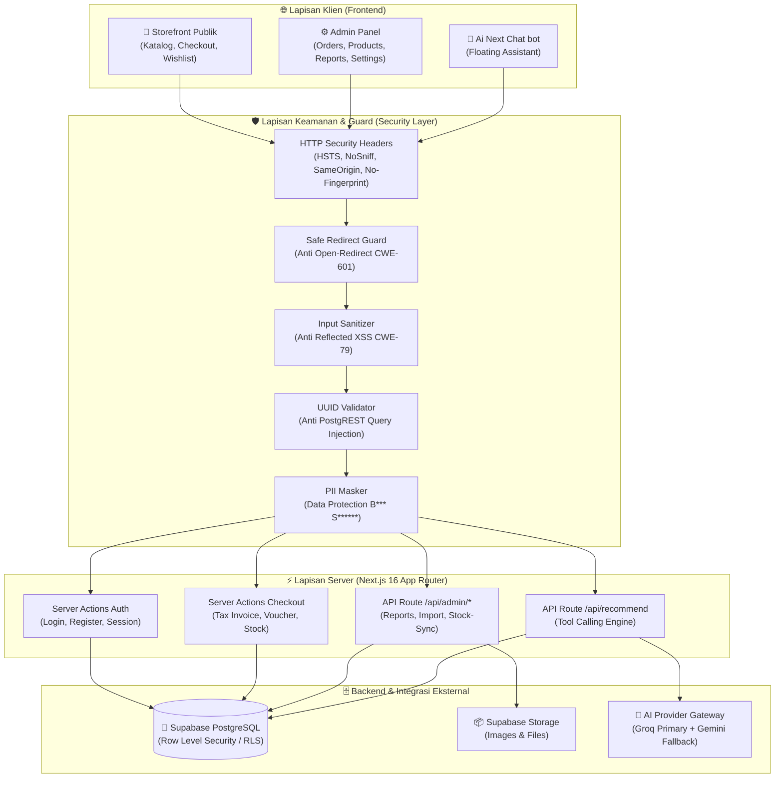
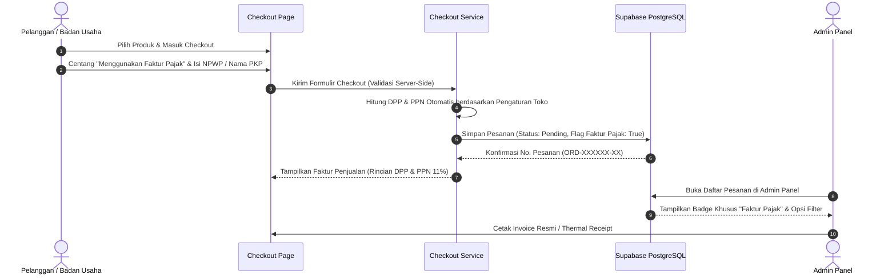

<div align="center">


# Next Solution Store

**Platform E-Commerce Modern Toko Komputer, Laptop & Solusi Elektronik**  
Dibangun menggunakan **Next.js 16 (App Router)**, **React 19**, **TypeScript**, dan **Supabase (PostgreSQL)**.

[](https://nextjs.org/)
[](https://react.dev/)
[](https://www.typescriptlang.org/)
[](https://supabase.com/)
[](https://tailwindcss.com/)
[](https://owasp.org/)
[](https://vitest.dev/)

</div>

---

## 🏛️ Gambaran Arsitektur Sistem

Berikut visualisasi aliran data, modul keamanan, serta keterhubungan antara antarmuka pengguna, server layer, dan backend database:



### 🔁 Alur Transaksi & Faktur Pajak PPN



---

## ✨ Fitur-Fitur Utama

### 1. 🏪 Storefront (Halaman Publik)
- **Katalog & Navigasi Cepat:** Filter multi-dimensi (kategori, brand resmi ASUS/Lenovo/Acer/MSI/HP, rentang harga, RAM, storage, processor, dan kartu grafis).
- **Badge Status Produk:** Label visual otomatis untuk produk **Baru**, **Terlaris**, dan **Promo Diskon**.
- **Perbandingan Produk:** Bandingkan spesifikasi teknis hingga 3 produk laptop/PC secara berdampingan.
- **Wishlist & Keranjang Interaktif:** Sinkronisasi instan dengan local state dan penyimpanan pengguna.
- **Ulasan Produk Terverifikasi:** Fitur rating bintang dan ulasan yang hanya dapat diberikan oleh pembeli sah dengan pesanan lunas yang telah diterima.

### 2. 🧾 B2B Faktur Pajak PPN (e-Faktur)
- **Opsi Faktur Pajak Saat Checkout:** Pelanggan institusi/perusahaan dapat mencentang opsi permohonan faktur pajak resmi dengan memasukkan NPWP/NIK, Nama Badan Usaha, dan Alamat Pajak.
- **Kalkulasi Otomatis DPP & PPN:** Nilai Dasar Pengenaan Pajak (DPP) dan PPN dihitung otomatis berdasarkan persentase tarif pajak yang dapat dikonfigurasi dinamis di Admin Panel.
- **Badge & Filter Admin Orders:** Di halaman admin pesanan, terdapat tanda visual badge khusus bagi pesanan yang membutuhkan faktur pajak, lengkap dengan filter kategori faktur.
- **Cetak Faktur Standar & Thermal:** Cetak dokumen faktur resmi A4 dan struk kasir thermal 58mm/80mm yang memuat rincian pajak secara rapi.

### 3. 🤖 Ai Next Chat bot
- **Asisten Toko & Konsultan Belanja:** Asisten virtual cerdas yang memahami katalog spesifikasi hardware dan informasi toko.
- **Lacak Status Pesanan:** Kemampuan membaca nomor pesanan secara langsung via tool calling yang dilindungi verifikasi identitas pemesan.
- **Dukungan Multi-Model Failover:** Menggunakan arsitektur failover cerdas antara Groq (primary) dan Google Gemini (fallback) untuk keandalan maksimal tanpa downtime.
- **Respons Sopan & Profesional:** Menjawab pertanyaan pengguna secara ramah dan to the point tanpa membocorkan rincian teknis internal sistem.

### 4. ⚙️ Admin Panel & Operasional Toko (`/admin`)
- **Dashboard Ringkas:** Pemantauan metrik penjualan, grafik pendapatan, dan pesanan masuk secara real-time.
- **Manajemen Pesanan:** Pembaruan status pesanan (Pending, Processing, Shipped, Delivered, Cancelled) dilengkapi notifikasi dan WhatsApp follow-up link.
- **Katalog & Upload Massal:** Tambah/edit produk, manajemen varian, serta upload massal via template Excel (pricelist Lenovo, Asus, dll.).
- **Sinkronisasi Stok:** Update stok multi-gudang dan gerai toko secara instan dari spreadsheet.
- **Audit Logs & Keamanan:** Rekam jejak seluruh aktivitas perubahan data penting oleh admin.

---

## 🔒 Standar Keamanan Sistem (Security Hardening)

Aplikasi telah diaudit secara menyeluruh dan diperkuat terhadap potensi kerentanan keamanan siber (OWASP Top 10):

| Area Proteksi | Mekanisme & Mitigasi | Standar CWE / OWASP |
|---|---|---|
| **Anti Server-Fingerprinting** | Header `X-Powered-By: Next.js` dinonaktifkan (`poweredByHeader: false`) agar versi dan framework backend tidak terumbar ke publik. | CWE-200 (Information Disclosure) |
| **HTTP Security Headers** | Konfigurasi header global: `HSTS` (max-age 2 tahun + preload), `X-Frame-Options: SAMEORIGIN` (anti Clickjacking), `X-Content-Type-Options: nosniff` (anti MIME sniffing), `X-XSS-Protection: 1; mode=block`, dan `Permissions-Policy`. | OWASP Security Headers |
| **Anti Open-Redirect** | Validasi terpusat via `getSafeRedirectUrl` di `lib/security.ts`. Menolak URL skema relatif (`//`), manipulasi backslash (`/\` atau `\`), dan bypass terenkode (`/%5c`). | CWE-601 (Open Redirect) |
| **Perlindungan Data Pribadi (PII Masking)** | Data pelanggan dan nama penerima paket pada asisten AI dan pelacakan publik disamarkan (*masked*, contoh: `B*** S******`) untuk mencegah *data harvesting*. | CWE-359 (Privacy Violation) |
| **Pencegahan Query Injection** | Parameter filter array pada PostgREST query difilter ketat dengan regular expression UUID (`/^[0-9a-f-]{36}$/i`) sebelum digabungkan ke clause `.or(...)`. | CWE-89 / PostgREST Injection |
| **Sanitasi Reflected XSS** | Parameter URL query string seperti pesan error disanitasi menggunakan `sanitizeReflectedString` (menghapus tag HTML dan karakter eksekusi skrip). | CWE-79 (Cross-site Scripting) |
| **PostgreSQL RLS (Row Level Security)** | Seluruh tabel Supabase PostgreSQL diproteksi dengan policy RLS fail-closed. Customer hanya dapat membaca datanya sendiri; role Admin divalidasi via fungsi server terpercaya. | OWASP Broken Object Level Auth |
| **Anti CSV / Formula Injection** | Ekspor laporan pesanan dan pelanggan menerapkan sanitasi karakter formula (`=`, `+`, `-`, `@`) untuk mencegah eksekusi skrip di Microsoft Excel. | CWE-1236 (Formula Injection) |

---

## 🚀 Panduan Instalasi & Menjalankan Proyek

### Prasyarat Sistem
- **Node.js**: Versi `20` atau `22` LTS ([Download Node.js](https://nodejs.org/))
- **npm**: Versi `10+` (termasuk bawaan Node.js)
- **Git**: [Download Git](https://git-scm.com/)
- **Akun Supabase**: [Daftar Supabase Gratis](https://supabase.com/)

---

### Langkah 1: Clone Repository
```bash
git clone https://github.com/moannn27/webpenjualannext.git
cd webpenjualannext
```

### Langkah 2: Install Dependensi
```bash
npm install
```

### Langkah 3: Konfigurasi Environment Variables
Salin file `.env.example` menjadi `.env.local`:
```bash
cp .env.example .env.local
```

Isi variabel environment di dalam `.env.local`:
```env
# Supabase Configuration (Wajib)
NEXT_PUBLIC_SUPABASE_URL=https://your-project-id.supabase.co
NEXT_PUBLIC_SUPABASE_PUBLISHABLE_KEY=your-anon-key
SUPABASE_SERVICE_ROLE_KEY=your-service-role-key

# Domain & Site URL (Wajib)
NEXT_PUBLIC_SITE_URL=http://localhost:3000

# AI Chatbot Provider (Opsional / Direkomendasikan)
GROQ_API_KEY=your-groq-api-key
GROQ_MODEL=llama-3.3-70b-versatile
GEMINI_API_KEY=your-gemini-api-key
GEMINI_MODEL=gemini-2.5-flash
LLM_PROVIDER_ORDER=groq,gemini

# Google OAuth Sign-In (Opsional)
NEXT_PUBLIC_GOOGLE_CLIENT_ID=your-google-oauth-client-id
```

> **Catatan Keamanan:** Jangan pernah menambahkan prefix `NEXT_PUBLIC_` pada `SUPABASE_SERVICE_ROLE_KEY`, `GROQ_API_KEY`, atau `GEMINI_API_KEY`. Kunci-kunci tersebut hanya boleh dieksekusi di sisi server.

### Langkah 4: Migrasi Database Supabase
Pastikan Supabase CLI telah terhubung ke project Anda, lalu jalankan seluruh migrasi database:
```bash
npm run db:push
```

### Langkah 5: Membuat Akun Super Admin
1. Jalankan aplikasi atau buka halaman registrasi di `/register`.
2. Daftarkan akun baru Anda.
3. Buka **Supabase Dashboard → Table Editor → tabel `users`**.
4. Ubah nilai kolom `role` pada baris akun Anda menjadi `super_admin`.
5. Login kembali di website untuk mengakses seluruh modul di `/admin`.

### Langkah 6: Menjalankan Server Development
```bash
npm run dev
```
Buka browser dan akses **[http://localhost:3000](http://localhost:3000)**.

### Langkah 7: Menjalankan Pengujian (Testing)
Untuk memastikan seluruh modul dan proteksi keamanan berfungsi 100%:
```bash
npm test
```
*Hasil: Seluruh 50+ test suite (550+ pengujian unit dan integrasi) akan dieksekusi.*

---

## 📦 Build Produksi & Deployment

Untuk melakukan build produksi sebelum deploy:
```bash
npm run build
```
Untuk menjalankan build produksi lokal:
```bash
npm start
```

Platform ini siap dideploy secara instan ke **Netlify** atau **Vercel** dengan memanfaatkan file konfigurasi yang sudah tersedia (`netlify.toml` / Next.js output).

---

<div align="center">
  <strong>Next Solution Store</strong> · Pusat Komputer, Laptop & Solusi Elektronik Resmi<br/>
  Jl. Kartini No.09 · Bandung
</div>
